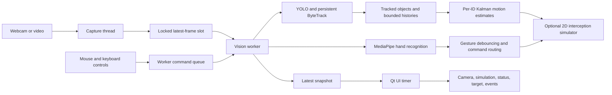

# JARVIS — Intelligent Robotic Vision and Gesture-Controlled Interception System

JARVIS is a modular computer-vision and robotics portfolio project. Phases 1
through 4 provide camera/video input, pretrained YOLO detection, persistent
ByteTrack IDs and trails, MediaPipe gesture controls, and per-object
Kalman-filtered image-space motion estimates. Phase 5 adds a software-only 2D
interception simulation; Phase 6 adds an interactive perception dashboard;
Phase 7 adds reproducible benchmarks and synthetic accuracy tests. Phase 8
replaces the default OpenCV window with a PySide6 desktop workspace and moves
capture and perception into background workers. The simulator does not connect
to physical hardware. Phase 9 preserves the COCO detector while adding an
optional YOLO-World detector and asynchronous per-track crop-classification
verification.

## Requirements

- Windows, macOS, or Linux
- 64-bit Python 3.11 (required by the pinned dependency set)
- A webcam, or a prerecorded video file

The first run downloads the lightweight `yolov8n.pt` model if it is not already
available to Ultralytics. CPU inference is supported; no GPU is required.

## Installation (Windows PowerShell)

From the project directory:

```powershell
py -3.11 -m venv .venv
.\.venv\Scripts\Activate.ps1
python --version
python -m pip install --upgrade pip
python -m pip install -r requirements-dev.txt
```

Check that `python --version` reports Python 3.11.x before installing. The
`numpy<2` requirement has no NumPy 1.x wheel for Python 3.13, so pip attempts a
source build and may fail with a compiler error. Python 3.13 is not supported
by this dependency set; installing build tools will not fix that version
mismatch.

If PowerShell prevents virtual-environment activation, use the interpreter
directly instead:

```powershell
.\.venv\Scripts\python.exe -m pip install -r requirements-dev.txt
```

## Run

Start the default webcam (camera index 0):

```powershell
.\.venv\Scripts\python.exe main.py
```

Use another camera index:

```powershell
.\.venv\Scripts\python.exe main.py --source 1
```

Process a prerecorded video:

```powershell
.\.venv\Scripts\python.exe main.py --source "C:\path\to\video.mp4"
```

Optional settings:

```powershell
.\.venv\Scripts\python.exe main.py --source "C:\path\to\video.mp4" --confidence 0.5
.\.venv\Scripts\python.exe main.py --source 0 --model yolov8n.pt --device cpu
.\.venv\Scripts\python.exe main.py --source "C:\path\to\video.mp4" --tracker bytetrack.yaml
```

If PowerShell script activation is restricted, use the venv interpreter
directly:

```powershell
.\.venv\Scripts\python.exe main.py --source 0
.\.venv\Scripts\python.exe -m pytest -q
```

The default launcher opens the PySide6 desktop workspace. Use
`--legacy-opencv` only when you specifically want the previous OpenCV HUD.

### Keyboard controls

- **Q** quit
- **M** start/stop webcam input (camera 0)
- **V** open a video-file chooser
- **D** enable/disable object detection
- **H** enable/disable gesture recognition
- **Space** or **T** pause/resume object tracking (the camera and hand gestures
  continue, so gestures can resume tracking)
- **L** lock/unlock the selected target
- **I** toggle the software interception simulation (requires a valid selected
  target with a motion estimate)
- **C** or **N** cycle through visible targets
- **R** reset tracker state and clear selection/modes

The desktop toolbar provides camera/video input, detection and gesture toggles,
pause/resume, target lock/cycling, interception, and reset actions. Click a
visible tracked box to select it; `M` toggles the default webcam and `V` opens
the video picker. A camera initialization failure is displayed in the
workspace so another source can be selected.

The workspace includes the live camera canvas, object and motion overlays, a
2D interception simulation, system and target details, gesture state, and a
bounded event history. The camera panel shows a stale-overlay age; boxes and
current-target predictions are hidden when the latest processed state is more
than 0.5 seconds old. Inference FPS and Qt canvas paint FPS are reported
separately.

### Phase 8 threading and performance controls

The window appears before model initialization. A camera-capture thread
publishes one latest frame, and a separate serialized vision worker initializes
and runs YOLO/ByteTrack, gestures, motion estimates, commands, and simulation.
The Qt thread only copies the newest frame for display, reads immutable
snapshots, and handles user input. When inference falls behind, intermediate
frames may be skipped rather than queued; the tracker receives only newly
captured measurements with their monotonic timestamps. The UI remains
responsive, but its camera can advance ahead of the detection overlays.

Use `--imgsz 480` or `--imgsz 640` to choose YOLO inference size; 640 remains
the default because no representative detection-quality evaluation has
justified lowering it. Gesture inference is sampled at the configurable
`GESTURE_PROCESSING_INTERVAL_SECONDS` (default 0.1 seconds), and capture and UI
refresh limits are set in `config.py`.

The legacy OpenCV path remains available through `--legacy-opencv`; its
processing and HighGUI rendering still run synchronously.

### Gesture controls

- **Pointing** selects the nearest tracked-object center in front of the index
  fingertip and within the pointing-ray tolerance.
- **Open palm** toggles object tracking pause/resume.
- **Pinch** locks the selected target; repeat after releasing the pinch to
  unlock. A target lock prevents pointing/cycling from changing the target.
- **Closed fist** toggles the software interception simulation.

Toggle gestures require a stable hold, then must be released or changed before
they can activate again. When tracking is paused, camera capture and MediaPipe
continue while YOLO/ByteTrack processing is suspended.

## Tests

Install the development dependencies and run all unit tests without a camera:

```powershell
.\.venv\Scripts\python.exe -m pip install -r requirements-dev.txt
.\.venv\Scripts\python.exe -m pytest -q
```

For a live check, run `.\.venv\Scripts\python.exe main.py` or pass a
prerecorded video with `--source "C:\path\to\video.mp4"`. Move two objects of
the same class through the camera: each should receive a distinct ID, keep
that ID while moving, and leave a colored trail. Click an object or press **C**
to select it; the selected box and trail are highlighted. If the selected
object leaves view, selection persists for up to the configured missed-frame
limit. Also verify the toolbar and keyboard controls and compare detections
with `--confidence 0.2` and `--confidence 0.7`.

The tracking tests use synthetic observations and a fake Ultralytics result
adapter to check ID preservation, histories, missed-track cleanup, selection,
ByteTrack's persistent API arguments, and rendered trails. Test actual
association quality using webcam or prerecorded video because ByteTrack's
association is performed by Ultralytics.

Gesture tests use synthetic 21-point hands to test classification, directional
selection, toggle debouncing/cooldown, no-hand state, and keyboard command
routing. Offscreen PySide6 tests verify window startup, camera-canvas and
simulation-canvas rendering, and control command dispatch. Motion tests use
synthetic object trajectories and report mean
Euclidean position error and root-mean-square error (RMSE) at 0.5, 1.0, and
2.0-second horizons. These are image-pixel errors on the tested ideal
constant-velocity trajectory, not real-world distance or a general accuracy
guarantee.

The synthetic constant-velocity run reported:

| Horizon | Mean position error | RMSE |
|---|---:|---:|
| 0.5 s | 0.05 px | 0.07 px |
| 1.0 s | 0.07 px | 0.09 px |
| 2.0 s | 0.11 px | 0.14 px |

For an end-to-end motion check, run the desktop workspace with a webcam/video
and move a selected object steadily. The camera view distinguishes measured
and filtered centers and displays
velocity/speed in pixels per second, direction, acceleration, predicted
positions, and reliability status. Predictions are only shown in detail for
the selected (or locked) ID; filters continue to update for other tracked IDs.
The constant-velocity filter state is `[x, y, vx, vy]`; each update builds
`F(dt)` from the elapsed measurement timestamps and applies
`x' = F(dt)x`, `P' = F(dt)P F(dt)^T + Q(dt)`. The measured center `[x, y]`
updates that prediction using the Kalman gain. Future image positions are
`(x + vx*t, y + vy*t)` and use the velocity-limited filtered estimate.

### Interception simulation (Phase 5)

Select a target (or lock it with **L** / pinch), then press **I** or hold a
closed fist to activate the simulator. The appended right-hand panel shows
the target history and predicted path, robot start/current position and path,
candidate meet point, ETA, distance, and current status. Press **I** or use a
closed fist again to stop. If the selected target is not currently visible or
has no motion estimate yet, activation is rejected with HUD feedback. A lost
target stops the controller without clearing the tracking or motion histories.

The planner models the target as `p(t) = p0 + v*t`. With response delay `d`,
robot speed `s`, and `tau = t - d`, it solves the earliest non-negative root
of `|p0 + v*(d + tau) - robot_position| = s*tau`. The solution is rejected
if it exceeds the maximum horizon or falls outside the image-space boundary.
The controller advances using elapsed frame time in configurable-rate
substeps, and replans from the latest filtered estimate. It reports
**INTERCEPTED** only when the simulated robot and target are within the
configured tolerance at the same simulated time; reaching an old candidate
point alone does not count.

Motion and robot coordinates are image pixels, not physical measurements.
This remains a point-effector software simulation: there is no camera-to-robot
calibration, arm kinematics, depth, collision model, or hardware output. The
target model assumes constant velocity between updates; poor estimates and
abrupt changes can make the candidate interception unstable.

Run the independent synthetic planner/controller tests with the full suite.
The reproducible test scenarios report interception rate, position/time
errors, and impossible-case detection:

| Synthetic metric | Result |
|---|---:|
| Successful interceptions | 3/3 |
| Mean robot-to-target error at interception | 6.92 px |
| Mean interception-time error vs. analytic plan | 0.038 s |
| Impossible cases identified | 1/1 |

These are deterministic, image-space test results for three ideal trajectories
with a 10-pixel acceptance tolerance; they do not represent real-world robot
accuracy.

```powershell
.\.venv\Scripts\python.exe -m pytest tests/test_interceptor.py -q
```

Dashboard event-log bounds/timestamps and legacy toolbar rendering have
separate tests:

```powershell
.\.venv\Scripts\python.exe -m pytest tests/test_dashboard.py -q
```

The optional legacy dashboard uses the OpenCV HighGUI window. The default
desktop application described below uses the new PySide6 workspace.

## Phase 8: desktop workspace, architecture, and performance

### Architecture

The PySide6 desktop interface is a presentation layer over the existing
perception and robotics modules. A capture thread and one serialized vision
worker publish latest-only frame and snapshot state; Qt widgets are only
updated by the UI thread.



`ByteTrackTracker` measures the time spent in the `model.track()` call and in
its own result conversion/history update. Ultralytics performs detector
inference and ByteTrack association within that `model.track()` call; the
benchmark therefore reports their combined duration rather than inventing a
detector-only or association-only split. The standalone `YOLODetector.detect`
helper is not the application's tracking path. `--legacy-opencv` remains an
available synchronous fallback.

### Reproducible benchmark

Run the end-to-end pipeline using deterministic generated 640x480 frames and
the configured YOLO model:

```powershell
.\.venv\Scripts\python.exe benchmark.py --frames 30 --warmup 5 --device cpu --imgsz 640
.\.venv\Scripts\python.exe benchmark.py --frames 30 --warmup 5 --device cpu --imgsz 480
```

Use prerecorded input, another model/device, or save the JSON report:

```powershell
.\.venv\Scripts\python.exe benchmark.py --source "C:\path\to\video.mp4" --frames 300 --warmup 10 --device cpu --output benchmark-report.json
```

The report includes model and gesture initialization, time to first processed
and rendered frame, per-stage mean/median/p95/min/max latency, processed
throughput, YOLO tracking-call throughput, Qt canvas update/render throughput,
optional process RSS/CPU measurements, environment details, and deterministic
synthetic motion accuracy. Frame timing statistics exclude the requested
warmup frames.
The Qt canvas is rendered offscreen; this update/render throughput is not the
full application GUI refresh rate. `psutil` is optional.

One CPU run per inference size on Windows 10, Python 3.11, and an 8-logical-CPU
Intel processor used CPU-only PyTorch, local `yolov8n.pt`, 30 generated
640x480 frames, and 5 warmup frames. The Phase 7 baseline below is the
user-provided previous run. Since benchmark implementations and run conditions
differ, these single-run numbers are indicative comparisons, not a controlled
speedup claim:

| Measurement | Phase 7 baseline | Phase 8, imgsz 640 | Phase 8, imgsz 480 |
|---|---:|---:|---:|
| Time to first processed/rendered frame | 15.46 s | 66.52 s | 28.58 s |
| YOLO initialization | 4.25 s | 29.73 s | 11.01 s |
| Gesture initialization | 2.84 s | 8.14 s | 4.33 s |
| `model.track()` + ByteTrack mean | 168.7 ms | 223.7 ms | 155.9 ms |
| Gesture call mean | 29.9 ms | 39.1 ms | 38.1 ms |
| HUD / Qt canvas render mean | 15.8 ms | 5.4 ms | 5.2 ms |
| Processed frame mean latency | 220 ms | 274.9 ms | 206.2 ms |
| Processed throughput | 4.54 FPS | 3.64 FPS | 4.85 FPS |
| Maximum sampled RSS | 479 MB | 605 MB | 597 MB |

The benchmark currently suggests YOLO inference remains the dominant measured
stage; gesture inference and Qt canvas updates are secondary. The tracker
adapter and motion estimator are negligible at this scale. These single-run results are
host-load-sensitive, so repeat controlled benchmarks before making
hardware/performance claims. The benchmark excludes window-compositor time,
and this environment had no CUDA device. Although 480px input reduced tracking
latency in this run, detection quality was not evaluated and the default
remains 640. Capture and inference now run in background threads, keeping the
UI responsive while allowing stale frames to be skipped.

A repeat of the 640px command during the current interface validation processed
30 generated frames with 5 warmups on the same reported Windows/Python/CPU
class. It measured 14.47 s to first processed/rendered frame, 62.6 ms mean
`model.track()` time, 8.3 ms mean gesture time, 75.6 ms mean end-to-end frame
latency, 13.22 steady-state processed FPS, and 607 MB maximum sampled RSS.
These single runs vary substantially, especially in initialization and model
latency; they are indicative measurements, not evidence that the interface
redesign caused a performance gain. The canvas timing is still offscreen.

The separately measured synthetic prediction scenario uses a known
65,25-pixel/second image-space trajectory, seeded 3-pixel Gaussian measurement
noise, and variable timestamps. After initialization, 98 predictions were
evaluated per horizon:

| Horizon | Mean position error | RMSE |
|---|---:|---:|
| 0.5 s | 2.72 px | 3.21 px |
| 1.0 s | 3.59 px | 4.44 px |
| 2.0 s | 5.40 px | 7.03 px |

These are synthetic test errors, not calibrated confidence values or live
camera performance. A separate analytic check found the reachable stationary
target's plan at 1.00 s and rejected a target moving away faster than the
simulated robot.

## Phase 9: broadened object recognition

The original COCO detector and its ByteTrack labels remain the default. Choose
the optional YOLO-World detector to prompt for additional object categories:

```powershell
.\.venv\Scripts\python.exe main.py --detector world
.\.venv\Scripts\python.exe main.py --detector world --classes "thermometer, stethoscope, microscope, wrench"
```

The default open-vocabulary prompt list in `config.py` includes common school,
office, household, and tool objects. These prompts are not a guarantee of
detection quality. YOLO-World replaces the detector model for that run; it
does not retrain the COCO model. Tracking IDs and the rest of the perception
pipeline remain the same.

An optional asynchronous MobileNetV3-Large ImageNet-1K crop classifier can
suggest a more specific label for an already detected track. The original
detector label and confidence are retained as provenance; a suggested label
is shown as refined only after two temporally consistent results pass the
configured score and margin thresholds. The selected/locked target is given
priority, while classification requests for other retained tracks are
rate-limited and queued with a fixed maximum size. Classification can be
disabled with the desktop control or `--no-classification`. The classifier
does not discover objects YOLO missed and cannot reliably verify arbitrary
categories outside ImageNet-1K. Its score is an uncalibrated softmax output,
not a probability.

The classifier model is loaded lazily in a background worker after a track
has enough observations; the first classification can therefore take longer
and temporarily compete with detector/gesture work for CPU. Install the
runtime dependencies from `requirements.txt`; the first classifier use
downloads torchvision's MobileNetV3 weights if not cached.

Use the benchmark tools for the target machine. Detector latency comparison
must use the same video, frame count, image size, CPU/GPU, and prompt list:

```powershell
.\.venv\Scripts\python.exe benchmark.py --detector coco --frames 60 --warmup 10 --device cpu
.\.venv\Scripts\python.exe benchmark.py --detector world --frames 60 --warmup 10 --device cpu
.\.venv\Scripts\python.exe benchmark_recognition.py --limit 30 --warmup 5
.\.venv\Scripts\python.exe benchmark_recognition.py --images "C:\path\to\labeled-image-folders" --limit 500
```

The recognition benchmark reports initialization time, per-crop latency,
sampled RSS, and CPU utilization. Without `--images`, it intentionally reports
no accuracy. For labeled accuracy, provide an `ImageFolder`-style directory
with meaningful class names matching ImageNet labels/synonyms; it reports
top-1/top-5, per-class results, and a confusion matrix. Such a dataset still
needs to represent the actual camera crops before the result can describe
JARVIS usage.

There is no labeled real-image collection in this repository, so real-crop
classification accuracy is **not measured**. Published ImageNet validation
accuracy describes the model's training benchmark, not JARVIS camera crops,
and is not reported as a project accuracy result. Likewise, the prompted
YOLO-World categories are not independently validated here.

For context only, Torchvision reports MobileNetV3-Large V2 at 75.274% top-1
and 92.566% top-5 on ImageNet-1K, with 5.48 million parameters, 0.22 GFLOPs,
and 21.1 MB of weights. Ultralytics reports YOLOv8s-worldv2 at 37.7 COCO
zero-shot mAP. These published model benchmarks are not measured JARVIS crop
accuracy; see the [Torchvision model card](https://docs.pytorch.org/vision/main/models/generated/torchvision.models.mobilenet_v3_large.html)
and [Ultralytics YOLO-World documentation](https://docs.ultralytics.com/models/yolo-world/).

On this Windows 10/Python 3.11 CPU-only environment (Intel Family 6 Model
140, 8 logical CPUs), one matched generated-frame benchmark per detector used
640x480 input, inference size 640, 10 processed frames, and 3 warmups:

| Measurement | COCO `yolov8n.pt` | YOLO-World `yolov8s-worldv2.pt` |
|---|---:|---:|
| Detector initialization | 9.81 s | 71.97 s |
| `model.track()` + ByteTrack mean | 224.76 ms | 553.60 ms |
| `model.track()` + ByteTrack median | 165.08 ms | 430.82 ms |
| `model.track()` + ByteTrack p95 | 560.64 ms | 1082.09 ms |
| End-to-end processed-frame mean | 270.89 ms | 585.12 ms |
| Steady-state processed throughput | 3.69 FPS | 1.71 FPS |
| Maximum sampled RSS | 606.49 MB | 764.63 MB |

This short run suggests a CPU trade-off: the tested YOLO-World configuration
took about 2.46x the mean tracking time, 2.16x the end-to-end frame latency,
and 1.26x the sampled total-process RSS of the COCO configuration. The timings
are host-load-sensitive, based on only seven post-warmup samples, and the
synthetic images are not an accuracy evaluation. The baseline provided for the earlier Phase 8 run (77.9 ms
tracking, 12.3 ms gestures, 96 ms end-to-end, 10.4 FPS, ~606 MB) used different
run conditions and should not be compared as a controlled speedup.

The standalone MobileNet benchmark used 20 synthetic crops after 3 warmups.
With weights cached, model initialization took 13.18 s; the first run,
including the initial weight download, took 15.62 s. Mean crop latency was
80.26 ms (median 75.62 ms, p95 123.23 ms). The separate benchmark process
sampled 344.29 MB peak RSS (44.43 MB before model initialization, 341.01 MB
after). This is whole-process memory in a classifier-only benchmark and must
not be interpreted as the model's incremental memory inside the existing
vision application. It also does not measure CPU contention while YOLO and
MediaPipe run concurrently. In the application, classifier requests are
asynchronous and globally rate-limited to one per second, but actual
end-to-end cost with active classification remains unmeasured.

### Holographic camera workspace and hand overlays

The desktop workspace now opens directly into a camera-first composition.
Branding and camera/system state are compact; target analysis and the 2D
interception simulation appear as small contextual overlays, while controls
and event history are tucked into the command palette. Click a tracked target
to select it. Press **Tab** to open/close commands and **Escape** to dismiss
the palette; the existing camera, source, pause, detection, gesture, target
lock/cycle, interception, and reset controls remain available there and via
the existing keyboard shortcuts.

The existing MediaPipe inference returns up to two hands. The largest hand
continues to drive the current single-hand gesture-command logic; the same
inference result now also exposes each detected hand's landmarks, handedness,
and geometric gesture for the renderer. The camera canvas draws a thin
landmark skeleton, fingertip/knuckle accents, a rounded convex-hull contour,
and gesture-specific feedback for pointing, open palm, pinch, and fist.
Handedness labels distinguish left and right when MediaPipe provides them.
Landmark positions are smoothed over brief continuous observations and
discarded immediately when a hand disappears or gesture recognition is
disabled. No separate inference or segmentation model is used.

The contour is a **landmark-derived convex-hull approximation**, not a
pixel-level hand silhouette. It can bridge gaps between extended fingers,
and occlusion, motion blur, camera lighting, or MediaPipe's own hand-tracking
quality can affect its shape. The worker currently publishes the latest
processed landmarks while capture may advance; stale overlays are hidden,
but a small spatial/time offset can remain at low inference throughput.

Run the app and use a webcam or prerecorded video to inspect the presentation:

```powershell
.\.venv\Scripts\python.exe main.py
.\.venv\Scripts\python.exe main.py --source "C:\path\to\video.mp4"
```

The UI screenshots generated for this phase use a synthetic illustrative
frame and hand landmarks; they demonstrate layout and overlay geometry, not
live gesture recognition quality or camera output. Live webcam worker startup
and frame processing were smoke-tested, but the available live run did not
validate actual hand gestures, simultaneous live hands, or interception.

### Demo and portfolio use

For a concise screen recording, run JARVIS with a prerecorded clip containing
several visible objects, then demonstrate ID trails and target cycling,
gesture/keyboard controls, selected-target motion predictions, and the
software-only interception simulation. Capture the full resizable window, include
the selected target analysis and event log, and label the interception as a
simulation. Do not present synthetic benchmark metrics as live footage or
physical robot results. Keep large recordings out of Git; common video
extensions are ignored.

**Resume description:** Built a modular real-time computer-vision dashboard
using YOLO, persistent ByteTrack IDs, MediaPipe gesture commands, and
timestamp-based per-object Kalman motion prediction; implemented and
benchmarked an image-space robotic interception simulator with reproducible
synthetic accuracy and performance tests.

### Known limitations

- Motion, trajectories, and interception are expressed in image pixels, not
  calibrated world coordinates. The interception feature is a software-only
  2D point simulator; there is no robot connection, depth, camera calibration,
  collision avoidance, or hardware safety layer.
- The predictor assumes constant velocity. Abrupt changes and long horizons
  can degrade estimates; reliability statuses are transparent heuristics, not
  statistical probabilities.
- CPU inference limits throughput and model initialization delays first
  output. Performance depends on input resolution, CPU/GPU, lighting, and the
  video content. The benchmark uses generated images and does not measure
  real-camera detection quality.
- Recognition remains model-limited: the default detector is closed-set COCO,
  YOLO-World quality depends on prompt wording, and MobileNetV3 only classifies
  crops it receives. No representative labeled crop dataset is included, so
  project-specific classification accuracy is unknown.
- The CPU benchmarks found YOLO-World substantially slower than COCO on this
  machine. MobileNet crop classification is asynchronous but still shares CPU
  resources with the other vision stages; active-classification end-to-end
  throughput has not yet been measured.
- Gesture recognition currently uses the largest detected hand for commands.
  Both hands can be visualized, but independent left/right-hand command
  assignment and gesture sequences are not implemented.
- CUDA was unavailable. The PySide6 workspace and generated-frame benchmark
  were tested offscreen, but the new Qt application has not been validated
  with sustained live-camera input or representative prerecorded footage.
  Detection quality, physical-camera switching, and sustained FPS still need
  a target-machine check.

## Dependency and compatibility notes

- Use 64-bit Python 3.11 for the pinned dependencies. Python 3.13 is not
  supported with `numpy<2`; use the Python 3.11 virtual environment rather
  than trying to compile NumPy or changing the compiler.
- `pytest` is intentionally isolated in `requirements-dev.txt`; install that
  file to run the test suite. Runtime installations can continue using
  `requirements.txt`.
- `numpy<2` constrains the install to the NumPy 1.x API for compatibility with
  the initial dependency set.
- `torch`, `torchvision`, and Pillow provide the optional MobileNetV3 crop
  classifier. For a CPU-only PyTorch build, select the appropriate wheel in
  the [official PyTorch installer](https://pytorch.org/get-started/locally/);
  the default detector and tracking path remains CPU-capable without CUDA.
- `PySide6` is the default desktop interface dependency. `--legacy-opencv`
  uses the retained OpenCV HighGUI interface.
- ByteTrack uses Ultralytics' built-in tracker API with `persist=True`.
  `--confidence` filters displayed detections; the lower tracker inference
  confidence and association thresholds are separate settings. If changing
  the missed-frame retention period, keep `TRACKING_MAX_MISSED_FRAMES` in
  `config.py` aligned with `track_buffer` in `bytetrack.yaml`.
- `lap>=0.5.12` is included because the installed Ultralytics tracking runtime
  requires it for ByteTrack's assignment step; listing it prevents a runtime
  auto-install on the first tracking call.
- IDs can change after the configured ByteTrack buffer expires or if objects
  cross/occlude in ways that confuse data association. ID switches are a
  limitation of visual tracking, not evidence that object classification is
  wrong.
- Gesture tuning is in `config.py`: detection/tracking confidence,
  processing resolution, stable-frame count, cooldown, pinch ratio, finger
  extension/folding ratios, thumb spread, and pointing angle/ray tolerance.
  Raise `GESTURE_STABLE_FRAMES` or `GESTURE_COOLDOWN_SECONDS` to reduce
  accidental toggles. If pointing misses targets, increase
  `POINTING_ANGLE_TOLERANCE_DEGREES`; if pinch triggers too easily, lower
  `PINCH_DISTANCE_RATIO`.
- Gesture classification is geometric and uses palm-relative distances. Hand
  rotation, heavy occlusion, poor lighting, and unusual camera angles can still
  reduce reliability; calibrate the above thresholds for the camera/view.
- Motion tuning is in `config.py`: prediction horizons, Kalman measurement and
  process noise, velocity cap, stationary threshold, lost-track retention,
  low-confidence residual threshold, and prediction history. Motion units are
  pixels and pixels per second in the camera image.
- Interception tuning is in `config.py`: robot start-position ratio, maximum
  speed, response delay, tolerance, maximum horizon, required prediction
  measurements, controller gain, update rate, and path history lengths.
- The Kalman model assumes constant velocity between observations. Direction
  changes and high residuals are marked LOW CONFIDENCE; longer horizons are
  more sensitive to unexpected motion. Predictions can lie outside the image
  bounds and are not clipped to the camera frame.
- If YOLO model download fails, check network access and try again. The model
  file is managed by Ultralytics and is not committed to this repository.

## Current structure

```text
config.py
main.py
requirements.txt
requirements-dev.txt
pytest.ini
benchmark.py
benchmark_recognition.py
bytetrack.yaml
application/
  capture.py
  pipeline.py
  worker.py
vision/
  detector.py
  recognition.py
  tracker.py
  gestures.py
  anime_gestures.py
  gesture_features.py
  gesture_sequences.py
  gesture_templates.py
  gesture_templates.json
  commands.py
prediction/
  kalman.py
  motion.py
robotics/
  interceptor.py
utils/
  video.py
interface/
  desktop.py
  visualization.py
  effects.py
  effect_renderer.py
  effect_library.json
  hud.py
tests/
  test_benchmark.py
  test_capture.py
  test_detector.py
  test_dashboard.py
  test_desktop.py
  test_visualization.py
  test_anime_gestures.py
  test_effects.py
  test_gesture_templates.py
  test_pipeline.py
  test_recognition.py
  test_recognition_benchmark.py
assets/
```

## Phase 8–10 status

The application now defaults to the PySide6 desktop workspace; the earlier
OpenCV interface is available as a fallback. Camera capture and vision
processing run off the Qt UI thread with a single-slot latest-frame strategy.
Phase 9 keeps the COCO detector as default, with YOLO-World and asynchronous
MobileNetV3 crop classification available as optional recognition paths. The
desktop is camera-first, with compact contextual overlays and landmark-based
visualization for up to two hands.

### Phase 10: configurable hand signs and procedural effects

The existing MediaPipe inference is reused. Each hand observation carries a
stable short-term identity, corrected handedness for mirrored/unmirrored input,
normalized landmarks, palm-relative shape features, confidence when supplied by
MediaPipe, and bounded position history. System-command gestures remain in
their original path. Anime/action matching excludes hands currently classified
as pointing, open palm, pinch, or fist, and has independent enable controls in
the command palette.

The initial, deliberately generic feature library recognizes **two-finger
focus** and a **two-hand seal** (both hands form that pose, remain close, and
have compatible projected orientation). The two-step **focus / seal** sequence
requires the first pose to release before advancing and cannot retrigger until
the final pose releases. These are geometric demo signs, not claims to recognize
any named anime franchise sign. Matching uses normalized finger-extension
states, not a learned model; the configured thresholds, hold times, sequence
timing, cooldown, mirroring assumption, and effect cap are adjustable in
`config.py` and `vision/gesture_templates.json`.

Recognized events map separately to original procedural effects: an attached
energy charge and aura while focus is held, lightning on release, an expanding
energy burst for the two-hand seal, and a moving fireball for the completed
sequence. Vector effects render over the camera image in the Qt canvas. Effect
state is time-based and bounded; effects can be disabled independently from
recognition. Feature-only calibration samples can be recorded through
`GestureSampleRecorder`; the JSON output stores derived features, never camera
frames or raw video.

The benchmark now reports feature extraction, finger-template matching,
single-/two-hand recognition, sequence updates, effect-state updates, and vector
render timings on deterministic synthetic inputs, alongside full-pipeline FPS
and sampled process memory. These timings are not gesture-accuracy results.

### Phase 11: camera-space abilities and calibration

The three priority abilities now use ability-specific recognition and rendering
paths. No anime footage or frames are included; all effects are generated by
the application.

- **Shadow Clone Jutsu** uses MediaPipe Pose upper-body landmarks plus the two
  independent hand tracks. The left and right elbow-to-wrist segments must cross
  the shoulder midline in front of the torso, both wrists must be associated
  with visible hands, and that geometry must remain stable for the configured
  hold. The midline test is invariant to horizontally mirrored input. Pose
  inference runs on sampled vision-worker frames, not GUI refreshes. Selecting
  Shadow Clone starts MediaPipe Selfie Segmentation initialization on a
  dedicated single-thread executor. At activation, one bounded camera-frame
  copy is segmented to produce at most the configured number of cropped RGBA
  person masks. The smoke-in transition is visible while masks are being
  generated. Cached copies have distinct tints, horizontal offsets, sway, and
  a bounded lifetime with a smoke-out transition. The application stores only
  those cropped, masked sprites for the active effect; it does not retain a
  rolling camera-frame history.
- **Domain Expansion** requires one visible hand and a recorded template. The
  Record pose control stores all 21 landmarks after wrist translation,
  palm-scale normalization, and aspect-ratio correction. The comparison
  preserves 3D finger shape and palm orientation and uses the configured
  similarity threshold; a second hand is not required. There is deliberately no
  fabricated default finger pose: record the recognizable sign from your
  camera before activation. Its original full-screen procedural effect has a
  brief flash, expanding boundary, indigo void tint, perspective lattice,
  animated spatial sigils and particles, sustained field, and timed collapse.
- **Kamehameha** requires two nearby, partially curled hands and a matching
  recorded two-hand hand-shape template. Pose matching uses all 21 normalized
  landmarks per hand; both hands must move together, with a forward depth
  component from timestamped MediaPipe hand `z` history. The held charge follows
  the tracked hands and renders a growing blue-white sphere, swirls, arcs, and
  inward-moving sparks. Release starts a screen-space beam from the current
  hand midpoint; the beam grows to the frame boundary and persists independently
  of subsequent hand visibility. This remains a 2D camera effect, not a
  calibrated physical projectile.

Open **COMMANDS**, choose **DOMAIN EXPANSION** or **KAMEHAMEHA**, and click
**Record pose** with exactly one or two hands respectively. Record several
samples under the intended camera angle and lighting; use **Pose similarity**
to adjust matching strictness. Kamehameha movement can additionally be recorded
with **Record movement** / **Stop movement**. Shadow Clone needs no hand-seal
template. The calibration file stores normalized landmarks and derived motion
features, never camera frames, and is Git-ignored at
`vision/ability_calibration.json`. A matched ability pose is evaluated before
system-command dispatch so its hand sign cannot accidentally fire a system
gesture.

Clone count, duration, opacity, spacing, mask resolution/threshold, and subtle
animation are configurable in `config.py`; ability hold and non-clone effect
durations are in `vision/ability_library.json`. Pose inference executes on the
existing vision worker; segmentation runs on a dedicated single-thread
executor so model initialization and masking do not block it. A single frame
is segmented on ability activation, not on each display refresh. The renderer
caches the bounded RGBA cutouts in the GUI thread. The domain tint remains an
overlay on the live camera view rather
than a reconstructed 3D environment; clone copies show the activation pose and
do not synthesize new body poses.

Run the dedicated segmentation/compositing microbenchmark with:

```powershell
.\.venv\Scripts\python.exe benchmark_ability_effects.py --width 640 --height 480 --iterations 8
```

On this Windows CPU, five warm segmentation/mask-crop iterations on a generated
silhouette averaged **23.20 ms** (p95 25.35 ms); cached three-sprite QPainter
compositing averaged **0.260 ms** (p95 0.277 ms). The first segmentation call,
including model initialization, took **1902.23 ms**; this initialization is
started asynchronously when Shadow Clone is selected. A separate live-camera
smoke check took **30.69 ms** for segmentation and produced three sprites.
These measurements describe component cost, not person-mask quality or gesture
accuracy. The live smoke check did not include a person performing an ability
pose.

The automated tests use synthetic landmarks, crossed-arm geometry, calibrated
templates, and a controlled person mask. They cover invalid/ambiguous poses,
single-hand Domain operation, mirrored crossing, hold timing, depth thrust,
release persistence, clone bounds/expiry, and full-screen compositing. A live
webcam trial and real-person gesture recording are still required before
claiming recognition reliability. Lighting, occlusion, camera framing, and
MediaPipe jitter can still affect results. Existing detection, tracking, gesture
controls, and software-only interception remain in the application.